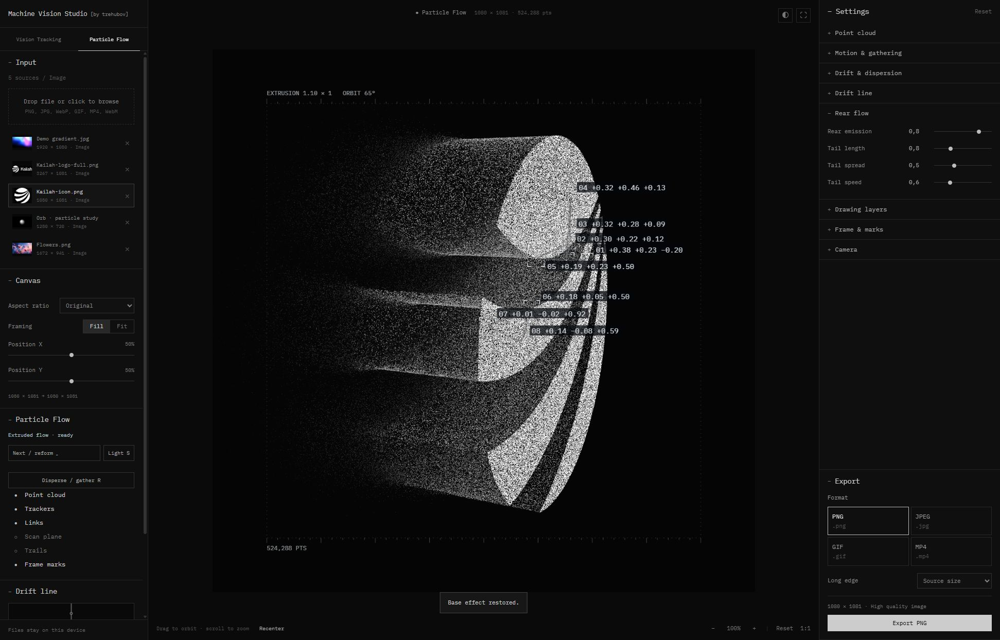

# Machine Vision Studio [by trehubov]

[Відкрити студію](https://machine-vision-studio.vercel.app/) · [GitHub](https://github.com/dsMagnatov/machine-vision-studio)



Самостійний інструмент, винесений з презентації Epsilon. Інтерфейс у стилі Grainrad; оригінальний рушій Vision із рухомими маркерами, координатами, лініями, колами, рамками, шумом та пікселізацією.

Студія має дві вкладки: **Vision Tracking** і **Particle Flow**. Вони використовують спільний імпорт, кадрування та експорт; вибір джерела й параметри ефекту зберігаються окремо для кожного інструмента протягом поточного сеансу.

Стартова колекція завжди містить рівно п’ять зображень у такому порядку: градієнт, **Kailah-logo-full.png**, **Kailah-icon.png**, **Orb** і **Flowers.png**. Обидва логотипи та квіти включені як оригінальні PNG. Колекція завантажується одразу для обох вкладок і відновлюється при кожному перезавантаженні сторінки. Додаткові імпорти та видалення зі списку діють лише до перезавантаження.

## Particle Flow

Режим за візуальним референсом Gather: хмара з 32 768–524 288 частинок, керована 3D-камера, розсипання й збирання, переходи Swarm/Melt та автоматична послідовність до чотирьох картинок. Рендерер написаний для цієї студії на WebGL 2. **Depth geometry** має три режими: **Solid extrusion** витягує силует у тіло з передньою і задньою гранями, боковими стінками та внутрішніми частинками; **AI volume** формує замкнений об’єм за оцінкою глибини; **AI surface** залишає попередню видиму поверхню. Solid extrusion ввімкнено за замовчуванням, а для Orb використовується аналітична сфера. AI-режими використовують локальний **FastDepth** в окремому Web Worker через ONNX Runtime Web. Модель включена до архіву; підключення до інтернету й API-ключ не потрібні. AI volume симетрично продовжує оцінену поверхню вглиб — зворотна сторона є побудованою формою, а не реконструкцією невидимих деталей фотографії.

- **Next / reform**, або **Space** — наступна картинка; для одного джерела — розсипання та повторне збирання.
- **Disperse / gather**, або **R** — повністю розсипати поточну картинку та зібрати її назад, не перемикаючи джерело.
- **Depth** задає товщину тіла: 0 — плоска картинка; зі збільшенням параметра силует витягується вглиб. **Depth stretch** додатково множить цю довжину, **Interior fill** регулює заповнення внутрішніми частинками. Бокові стінки повторюють зовнішній контур та отвори логотипа; колір граней береться з оригіналу, боки мають легке затінення. Камера відступає зі збільшенням товщини. **Depth smoothing** пом’якшує карту AI-режимів. **Retry** повторює аналіз у разі помилки. Для AI-відео карта глибини оновлюється під час програвання, а при експорті переобчислюється з кроком 0,2 с. Solid extrusion працює без AI-аналізу; контури відео оновлюються під час програвання та експорту.
- **Source colors** увімкнено за замовчуванням: частинки зберігають RGB оригіналу, включно з темними кольоровими ділянками. Початкові Exposure і Contrast — нейтральні.
- **Image saturation** окремо регулює насиченість оригінального зображення: 0 — відтінки сірого, 1 — оригінальні кольори, 2 — підсилення кольору.
- **Light**, або **S** — світловий імпульс у хмарі.
- Перетягування по прев’ю обертає камеру, колесо змінює її наближення. **Recenter**, або **0**, повертає початкову камеру.
- **Drift & dispersion**: **Drift** керує кількістю та віддаленням піщинок з вибраної сторони. **Edge softness** задає м’яку межу між цілісною формою й розпадом, **Drift spread** — довжину шлейфа, **Drift speed** — швидкість, **Turbulence** — завихрення. Частинки мають різні фази руху, тому біля об’єкта лишається щільне ядро з поступовим переходом у тонкий шлейф. Цикли з’єднані без стрибків положення, швидкості та прискорення.
- **Splash**, **Gather speed** і **Transition softness** керують швидкістю розльоту, поверненням та м’якістю переходу. Розсипання має радіальний розподіл без прямокутної межі хмари. Зміни Drift і Depth плавно підхоплюються під час анімації; на паузі параметри застосовуються відразу для точного підбору кадру. Вибір іншого зображення зі зупиненою анімацією показує його одразу, без незавершеного переходу.
- **Drift line** — перетягування центру пересуває лінію, кінця — обертає. Стрілки змінюють кут і позицію, **F** перемикає сторону розсипання.
- **Trackers**, **Links**, **Scan plane**, **Trails**, **Frame marks** вмикаються окремо.
- Трекери плавно переміщуються по ознаках картинки, реагують на її об’єм і розпад; квадрати змінюють розмір. Кожен трекер з’єднаний із двома найближчими сусідами. **Tracker size**, **Tracker color** і **Tracker opacity** керують розміром, кольором та прозорістю квадратів і координат. **Number background** у Drawing layers незалежно вмикає або повністю прибирає контрастні підкладки цифр; самі координати залишаються.
- У **Drawing layers** окремі **Number size** (6–36 px) та **Link thickness** (0,3–6 px) налаштовують розмір координат і товщину зв’язків незалежно від квадратів трекерів. Підкладка координат підлаштовується під шрифт. Розміри пропорційно масштабуються для роздільності кадру; параметри діють у прев’ю й усіх форматах експорту.
- **Link color** і **Link opacity** окремо налаштовують зв’язки між трекерами. Палітра застосовує колір під час вибору та після підтвердження; оновлення статусу не скидає її активний вибір. Для яскравого кольору можна підвищити Link opacity і Link thickness. **Frame & marks** містить колір, насиченість і прозорість зовнішньої рамки, лінійки та її числових підписів. Для кольору є палітра, введення HEX та **Auto**, що повертає контрастний колір відповідно до чорного/білого тла. Нульова прозорість повністю прибирає відповідний шар, включно з його підкладкою.
- **Invert luminance** дозволяє зробити частинками темні частини картинки, наприклад чорний логотип на білому тлі. **Paper** перемикає чорний і білий фон.
- **Cycle pictures** переходить між вибраною картинкою та іншими імпортованими картинками, до чотирьох за цикл. Відео обробляється як окреме динамічне джерело. Стартові зображення доступні відразу після запуску; перемикання вкладок не додає їх повторно.
- PNG/JPEG зберігають поточний ракурс; MP4/GIF — рух частинок і переходи. Для відеоджерел MP4 зберігає оригінальний звук. Файли цього режиму мають суфікс `particle-flow`.

## Запуск

Двічі клацніть **start-studio.cmd**. Або виконайте в цій папці:

```sh
node preview.mjs --open
```

Адреса: http://127.0.0.1:4180/. Залиште вікно сервера відкритим під час роботи. Потрібен Node.js 20.11 або новіший; файл запуску також уміє використовувати Node.js із локального встановлення Codex.

## Публікація

Production: **https://machine-vision-studio.vercel.app/**. Проєкт Vercel зв’язаний із цим GitHub-репозиторієм: push у `main` публікує нову версію. Налаштування збережені у `vercel.json`: Application Preset — Other, Output Directory — `dist`, без встановлення залежностей та кроку збірки. Змінні середовища не потрібні.

Перевірки: `npm test` (30 тестів).

## Робота

- **Input** — натисніть область завантаження або перетягніть файли у вікно. Можна додати кілька файлів і перемикатися між ними.
- Растрові зображення: PNG, JPG, WebP, GIF, BMP, AVIF. Анімовані зображення використовуються як статичний кадр. SVG не імпортується.
- Відео: MP4, WebM та інші контейнери, які декодує браузер. Прев’ю приглушене; є пауза і вибір кадру. Оригінальний звук зберігається в MP4-експорті. Якщо кодек не підтримується, студія покаже помилку й збереже попередній файл.
- **Canvas** — співвідношення сторін: оригінальне, 1:1, 4:5, 3:4, 2:3, 9:16, 16:9, 4:3, 3:2. **Fill** кадрує, **Fit** вміщує весь кадр. Position X/Y зміщують зображення.
- **Effects / Settings** — налаштування ефекту. **Presets** — чотири готові варіанти для вибраного інструмента. **Reset** повертає початковий ефект. Окремі кольори Particle Flow описано вище.
- **Pixelate zones** — увімкніть Place zones та клацніть на прев’ю. Escape завершує розміщення; Undo/Clear змінюють зони.
- **Export** — PNG, JPEG, MP4 або анімований GIF. PNG/JPEG зберігають поточний кадр із ефектом. MP4/GIF кодують послідовність кадрів з анімацією ефекту та вихідного відео.
- **MP4 quality** — Maximum: 60 fps / 32 Mbps; High: 60 fps / 16 Mbps; Medium: 30 fps / 8 Mbps; Low: 24 fps / 4 Mbps. Файл містить H.264-відео та оригінальний звук, якщо він є у джерелі. Аудіо зберігається як AAC зі збереженням частоти дискретизації та каналів. При експорті уривка звук обрізається синхронно з відео; при повторі відео повторюється і звук. Якщо браузер не має AAC-енкодера, використовується включений локальний WASM-енкодер. Maximum — високий бітрейт, а не математично безвтратне кодування. MP4 потребує H.264-енкодера WebCodecs; якщо вибраний розмір/FPS не підтримується браузером, студія запропонує зменшити якість або розмір.
- **GIF quality** — Maximum: 30 fps / 256 кольорів; High: 24 fps / 256; Medium: 15 fps / 128; Low: 10 fps / 64. GIF зациклений, тривалість до 20 секунд, довга сторона до 1280 px.
- **Long edge** — вихідний розмір або 480/640/720/1080/1920/2560/3840 px. Для MP4 довга сторона обмежена 3840 px, розміри округлюються до парних чисел. Прев’ю та підпис експорту показують фактичний розмір.
- **Duration / Start** — тривалість і початок уривка; для MP4 можна ввімкнути **Full video**, щоб зберегти всю тривалість файлу. Для статичної картинки MP4/GIF анімують ефект. Коротке вихідне відео повторюється, якщо уривок довший за нього.
- Експорт показує прогрес, дозволяє **Cancel** та після завершення дає посилання для повторного завантаження. Відеопрев’ю під час експорту призупиняється та потім продовжує відтворення. Додаткового MP4-плеєра під кнопкою експорту немає.

Імпорт, обробка та кодування відбуваються на пристрої. Сервер лише віддає файли інтерфейсу; завантажені зображення й відео нікуди не надсилаються. Перезавантаження сторінки очищає імпортовані файли та зміни. Прев’ю має зменшену роздільність для швидкості; експорт рендериться окремо у вибраному розмірі. Для великих статичних файлів діє межа 8192 px по довгій стороні та приблизно 24 мегапікселі. Для анімації діє межа розміру файлу у пам’яті приблизно 256 MB; для великих відео зменште бітрейт або тривалість.

## Файли

- `dist/vision/engine.js` — оригінальний рушій ефектів.
- `dist/vision/particle-engine.js`, `particle-shaders.js`, `particle-motion.js`, `particle-model.js`, `particle-geometry.js` — GPU-хмара, контури й бокові стінки екструзії, сфера, 3D-камера, узгоджений рух частинок і трекерів, переходи та параметри Particle Flow.
- `dist/vision/depth-model.js`, `depth-worker.js`, `depth-fields.js` — локальний FastDepth, попередня обробка, стабілізація діапазону відстаней і вирівнювання карти глибини з кадруванням.
- `dist/vision/preset.js` — базові параметри з попередньої студії.
- `dist/vision/app.js` — імпорт, відео, прев’ю, експорт.
- `dist/vision/starter-media.js` — п’ять стартових зображень та незмінний Orb.
- `dist/vision/ui.js`, `ui.css` — окремий інтерфейс.
- `dist/vision/formats.js`, `media.js` — формати полотна та завантаження медіа.
- `dist/vision/animation-export.js`, `export-options.js`, `gif-worker.js` — MP4, GIF, пресети якості та фоновий GIF-енкодер.
- `dist/vision/video-frames.js` — послідовне декодування відео для експорту без повторного перемотування для кожного кадру; для непідтримуваних WebCodecs-кодеків використовується декодер браузера.
- `dist/vision/audio-export.js`, `audio-timeline.js` — оригінальна аудіодоріжка, точне обрізання PCM та синхронізація повторів.
- `dist/vendor/` — локальні Mediabunny 1.62.1, AAC-енкодер 1.62.1, gifenc 1.0.3, ліцензії та вихідні архіви. `depth/` містить FastDepth і ONNX Runtime Web 1.17.3 (MIT) з ліцензіями й посиланнями на джерела.
- `dist/assets/` — стартовий градієнт, оригінальні PNG-логотипи та квіти, шрифт IBM Plex Mono та його OFL-ліцензія. Orb генерується локально без зовнішніх файлів.

Встановлювати залежності та запускати збірку не потрібно: бібліотеки вже включені у `dist/vendor/`. Папку можна перенести на інший комп’ютер із Node.js. Усі файли для інтерфейсу розміщені у `dist/` і можуть обслуговуватися будь-яким статичним HTTP-сервером.
